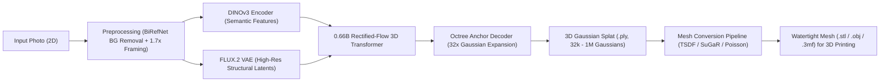
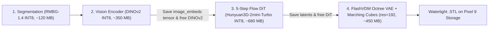
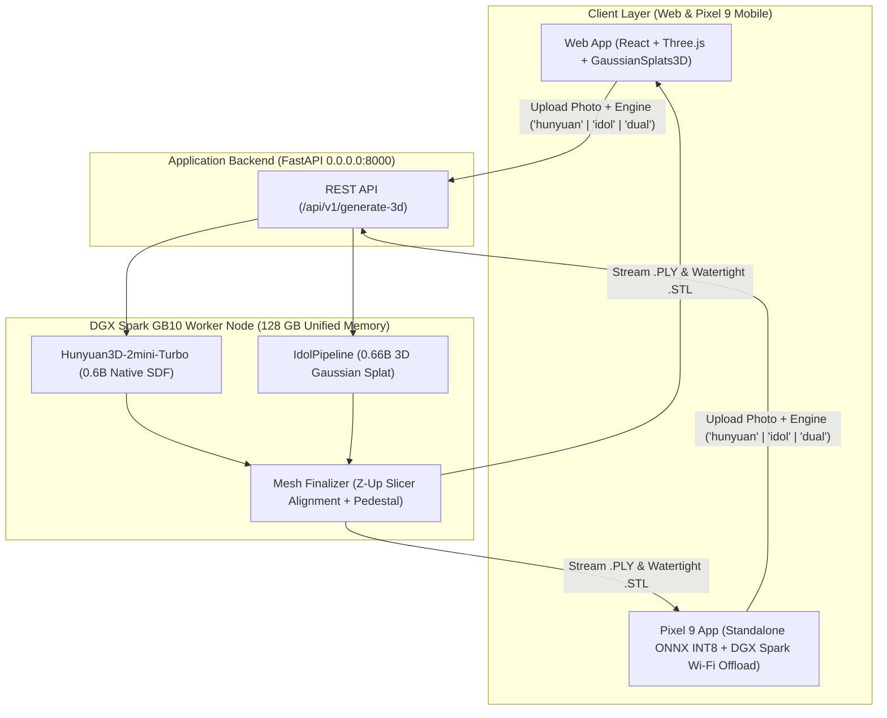

# Building a Photo-to-3D App with `speridlabs/idol-sdk` & `Hunyuan3D-2mini-Turbo` (Web, DGX Spark & Standalone Pixel 9)

## 1. Understanding `speridlabs/idol-sdk`

[**`speridlabs/idol-sdk`**](https://github.com/speridlabs/idol-sdk) is an open-source (Apache 2.0) inference SDK for **Idol**, a 0.66B-parameter 3D Diffusion Transformer (Rectified Flow Transformer) developed by Sperid Labs. It transforms a **single 2D image** (real-world photograph, render, or AI image) into a complete 360° **3D Gaussian Splat (`.ply`)** in seconds on a single consumer GPU (~7.2 GB VRAM).

### How the Idol Pipeline Works Under the Hood


1. **Automated Preprocessing (`--mode real` vs `--mode synthetic`)**:
   - Uses **BiRefNet** to automatically strip the background from a phone photo.
   - Crops, centers, and applies a framing factor (`1.7x` in `real` mode) so the object sits cleanly in canonical space.
2. **Dual Visual Conditioning**:
   - **DINOv3 (`facebook/dinov3-vith16plus-pretrain-lvd1689m`)**: Extracts rich 3D-aware semantic features so the model understands what the object is and what its unseen back/sides should look like.
   - **FLUX.2 VAE (`black-forest-labs/FLUX.2-dev`)**: Preserves sharp pixel-level surface details.
3. **Rectified-Flow 3D Transformer + Octree Decoding**:
   - Jointly denoises the 3D latent volume and camera pose.
   - Uses an **octree decoder** to predict coarse spatial anchors, then expands each anchor into 32 local 3D Gaussians—scaling from **32,768** (fast preview) up to **1,048,576** Gaussians (high detail).

---

## 2. Why Gaussian Splatting Isn't Immediately 3D-Printable (And How to Bridge It)

### 3D Gaussian Splatting (3DGS) vs. 3D Printing Meshes
| Property | 3D Gaussian Splat (`.ply`) | 3D Printing Mesh (`.stl` / `.3mf` / `.obj`) |
| :--- | :--- | :--- |
| **Representation** | Cloud of fuzzy, semi-transparent 3D ellipsoids with view-dependent color (Spherical Harmonics) | Watertight (manifold) surface made of connected triangles with a clearly defined inside & outside |
| **Strengths** | Ultra-fast generation, photorealistic rendering, handles thin/fuzzy structures well | Required by slicers (Bambu Studio, PrusaSlicer, Cura) to compute toolpaths and infill |
| **Failure Mode in Slicers** | Slicers cannot slice a cloud of disconnected ellipsoids directly | Non-manifold edges, holes, or floating internal geometry cause slicing failures |

### 3 Ways to Convert Idol's Gaussian Splats into Printable 3D Meshes

To make your app both a **fun interactive 3D Splat viewer** and a **3D-printing creator tool**, add a **Post-Processing Mesh Extraction stage** on the backend:

#### Approach A: Multi-View Depth Fusion (TSDF + Marching Cubes) — *Fastest & Most Reliable for Idol*
Since `idol-sdk` produces a clean 360° Gaussian Splat of an isolated object:
1. Render 36–72 orbital views (RGB + expected Gaussian depth + alpha mask) around the generated `.ply` using the `gsplat` or `diff-gaussian-rasterization` rasterizer (takes < 0.5 seconds on GPU).
2. Fuse the depth maps into a **Truncated Signed Distance Field (TSDF)** volume using `Open3D` (`open3d.pipelines.integration.ScalableTSDFVolume`).
3. Extract a surface mesh with **Marching Cubes**, then run `trimesh` / `manifold3d` to make it 100% watertight and export `.stl` or `.3mf`.

#### Approach B: Point-Cloud Normal Estimation + Screened Poisson Reconstruction
1. Filter out low-opacity Gaussians ($\alpha < 0.1$) from `output.gaussian`.
2. Treat the Gaussian centers $(x, y, z)$ as a dense point cloud (up to 1M points) and derive normals from the shortest axis of each Gaussian's covariance quaternion/scale matrix (or orient normals outward via `Open3D`).
3. Run **Screened Poisson Surface Reconstruction** (`open3d.geometry.TriangleMesh.create_from_point_cloud_poisson(pcd, depth=9)`), crop low-density artifacts, and export to `.stl`.

#### Approach C: Hybrid Pipeline (Preview in 3DGS, Print via Mesh-Native Model or GOF/SuGaR)
- Use `idol-sdk` (`num_gaussians=262_144`) for an **instant 2-second interactive 3D Gaussian Splat preview** on the user's phone/browser.
- When the user taps **"Prepare for 3D Print"**, run either the TSDF/Poisson extractor above or pass the segmented image into a companion SDF/Mesh model (e.g., TRELLIS.2 / NVIDIA PartPacker / Hunyuan3D-2.1 / TripoSG) to output a sharp CAD-ready `.stl`.

---

## 3. Landscape of Image-to-3D Models (NVIDIA & Open-Weights Comparison)

If your end goal is **3D printing**, it helps to understand where `idol-sdk` sits relative to **NVIDIA's 3D models** and other open-weights **Mesh / SDF native** generators.

### Summary Comparison Table

| Model | Creator | Release Date | Model Size (Params) | VRAM Needed | Native Output | 3D Print Readiness | License |
| :--- | :--- | :--- | :--- | :--- | :--- | :--- | :--- |
| **Idol (`idol-sdk`)** | Sperid Labs | Oct 2026 | **0.66B** core (~1.8B w/ encoders) | **~7.2 GB** | 3D Gaussian Splat (`.ply`, up to 1M splats) | Needs Splat-to-Mesh post-processing (Poisson / TSDF) | Apache 2.0 (encoders gated) |
| **PartPacker** | **NVIDIA Research** | June 2025 | **~1.5B** (DiT + Dual-Volume VAE) | **~10 GB** (FP16) | **Separable Multi-Part Meshes** (`.glb` / `.stl` / `.3mf`, $512^3$) | **Excellent** (generates separate printable parts!) | NVIDIA Source Code License |
| **LLaMA-Mesh** | **NVIDIA** & Tsinghua | Nov 2024 | **8B** (Llama-3.1-8B fine-tune) | ~16 GB | Direct `.obj` vertices & faces via LLM tokens | Low–Medium (low-poly artistic/blockout meshes) | NVIDIA / Llama 3.1 License |
| **Edify 3D** | **NVIDIA** (NIM / Picasso) | Nov 2024 | Proprietary multi-stage DiT | Cloud API | Quad/Triangle Mesh + 4K PBR Textures | High (clean topology, commercial API only) | Commercial API |
| **Latte3D** | **NVIDIA Research** | Mar 2024 | Amortized U-Net / Triplane | ~24 GB | Textured Mesh (< 1 sec from prompt/image) | Medium (designed for real-time virtual scenes) | Research / Closed |
| **TRELLIS.2** *(and TRELLIS v1)* | Microsoft Research | Dec 2025 *(v1: Dec 2024)* | **4B** (`TRELLIS.2-4B`) / **2B** (`v1`) | ~16–24 GB | **O-Voxel -> `.glb` Mesh** ($1536^3$) or **3DGS** | **Excellent** (ultra-sharp geometry & native mesh/3DGS) | **MIT License** |
| **Hunyuan3D 2.1** *(and 2.0 / 2mini)* | Tencent | June 2025 *(2.0: Jan 2025)* | **1.1B–3.3B** (Shape DiT) + **2B** (Paint) / **0.6B** (`2mini`) | ~5.8 GB (`2mini`) / ~10 GB (shape) | **Watertight SDF Mesh** (`.obj` / `.glb` / `.stl`) | **Excellent** (industry-leading sharp edges for 3D printing) | Tencent Community License |
| **TripoSG** | VAST / Tripo AI | Mar 2025 | **1.5B** (Rectified Flow + SDF VAE) | ~10–12 GB | **Signed Distance Field (SDF) -> Mesh** | **Excellent** (trained on 2M curated SDF pairs; very clean normals) | MIT License |
| **SAM 3D** (`Objects` & `Body`) | Meta AI | Nov 2025 | Foundation model suite | ~12–16 GB | Textured 3D Object & Human Body Meshes | High (great for in-the-wild photo segmentation + 3D) | Meta SAM License |
| **SPAR3D** *(and SF3D)* | Stability AI | Jan 2025 *(SF3D: Aug 2024)* | **~1.1B** (Point Diffusion + Triplane LRM) | **~7–8 GB** | Point Cloud + UV-Unwrapped Mesh in **0.7s** | Medium–High (super fast, allows point-cloud editing before meshing) | Stability Community License |
| **TripoSR** | Stability AI & Tripo | Mar 2024 | **~0.3B** (300M Transformer LRM) | **~6 GB** | NeRF Triplane -> Marching Cubes Mesh (0.5s) | Medium (fast & lightweight, but softer geometry than 2025/2026 DiTs) | MIT License |

---

### Deep Dive into Key Alternatives

#### 1. NVIDIA's 3D Model Ecosystem
NVIDIA has tackled 3D generation across several distinct architectures depending on the use case:
* **NVIDIA PartPacker (`NVlabs/PartPacker`, June 2025 — ~10 GB VRAM)**:
  * **Why it's special for 3D Printing:** Almost all image-to-3D models output a single fused "blob" mesh. **PartPacker** uses a *Dual Volume Packing* Diffusion Transformer to decompose a single 2D image into **separate, semantically meaningful 3D parts** at $512^3$ resolution. For 3D printing, this means you can print different parts in different filament colors, print moving/articulated assemblies, or orient individual parts to minimize support material.
* **NVIDIA Edify 3D (Nov 2024) & Latte3D (Mar 2024)**:
  * **Edify 3D** is NVIDIA's enterprise microservice (available via NVIDIA NIM / Shutterstock) focused on clean quad/triangle topology and 4K PBR textures.
  * **Latte3D** pioneered sub-second (~400ms) amortized 3D generation using triplane representations.
* **NVIDIA LLaMA-Mesh (Nov 2024 — 8B parameters)**:
  * Fine-tuned from `Llama-3.1-8B-Instruct`, it outputs `.obj` vertex and face coordinates directly as text tokens—allowing conversational 3D mesh generation and editing.

#### 2. Top Open-Weights Native-Mesh Models for 3D Printing
If you want crisp mechanical edges or watertight meshes *without* converting from Gaussian Splats:
* **Microsoft `TRELLIS` (2B, Dec 2024) & `TRELLIS.2` (4B, Dec 2025)**:
  * Uses a unified Structured Latent (`SLAT` / `O-Voxel`) representation that can decode the **exact same latent** into **both a 3D Gaussian Splat AND a high-resolution Mesh** (up to $1536^3$ in `TRELLIS.2`). Licensed under **MIT**.
* **Tencent `Hunyuan3D 2.0 / 2.1` (1.1B–3.3B Shape DiT, Jan–June 2025) & `Hunyuan3D-2mini-Turbo` (0.6B, Mar 2025)**:
  * Since 3D printing (FDM/SLA) only needs geometry (no UV paint texture required), you can run **only the `Hunyuan3D-DiT` shape model** (especially the `0.6B` `2mini-turbo` model) in ~5.8 GB VRAM. It uses a Signed Distance Function (SDF) decoder (`FlashVDM`), producing watertight, razor-sharp meshes ready for slicers in 5–6 steps.
* **Tripo AI `TripoSG` (1.5B, Mar 2025)**:
  * Specifically uses **SDF + surface normal + eikonal loss supervision** during training, which eliminates the "lumpy/melted" surfaces common in older NeRF/3DGS conversions.
* **Stability AI `SPAR3D` (Jan 2025)**:
  * Generates a 3D point cloud in stage 1 and a mesh in stage 2 in **0.7 seconds**. Users can actually edit the intermediate point cloud in the UI before the final mesh is generated.

---

## 4. Running `Hunyuan3D-2mini-Turbo` (0.6B) Standalone On-Device on Google Pixel 9

Because **`Hunyuan3D-2mini-Turbo` (0.6B)** uses ~5.8 GB VRAM in FP16 and only requires **5–6 diffusion steps** via `FlashVDM` consistency distillation, it is uniquely suited to run **standalone on a Google Pixel 9** when quantized to INT8.

### 1. Pixel 9 Hardware vs. `Hunyuan3D-2mini-Turbo` Memory Budget

| Resource | Google Pixel 9 (Base) / Pixel 9 Pro | `Hunyuan3D-2mini-Turbo` (Desktop FP16) | `Hunyuan3D-2mini-Turbo` (Mobile INT8 / W8A16) |
| :--- | :--- | :--- | :--- |
| **SoC & Compute** | **Google Tensor G4** (8-core ARMv9 CPU + **Mali-G715 MP7 GPU** w/ Vulkan 1.3 & OpenCL + EdgeTPU) | CUDA FP16 / BF16 | **ONNX Runtime Mobile (Vulkan / XNNPACK)** or **PyTorch ExecuTorch** |
| **System RAM** | **12 GB LPDDR5X** (16 GB on Pro); ~4 GB reserved by Android OS & AICore -> **~6–7 GB usable per app** (with NDK native heap) | ~5.8 GB peak VRAM (`octree_resolution=380`) | **~1.9 – 2.4 GB peak RAM** (`octree_resolution=192–256`) |
| **Model Weights on Disk** | Stored in Android app `filesDir` | ~2.4 GB (`safetensors` FP16) | **~850 MB** (INT8 quantized `.onnx` / `.pte`) |
| **Inference Steps & Latency** | 5–6 steps (`FlashVDM` consistency distilled) | ~1.8 seconds (DGX Spark GB10) | **~18–30 seconds** on Pixel 9 Mali-G715 GPU |

> [!IMPORTANT]
> **Why Quantization Matters on Pixel 9:** Even though Pixel 9 has 12 GB unified RAM, Android's Low-Memory Killer (`lmkd`) will terminate a foreground app if its native allocation spikes above ~6 GB. By quantizing `Hunyuan3D-2mini-Turbo` from FP16 to **INT8 weight-only (`W8A16`)** and sequentially unloading the image encoder before running the 5-step DiT and FlashVDM decoder, peak memory stays at **~2.1 GB**—running reliably on any Pixel 9!

### 2. Sequential On-Device Execution Pipeline for Pixel 9

Instead of keeping all 3 sub-networks in RAM simultaneously (which takes ~5.8 GB), the standalone Pixel 9 app runs them in **3 sequential stages**, freeing memory between each stage:



### 3. Exporting `Hunyuan3D-2mini-Turbo` to ONNX INT8 (Run on your DGX Spark)

You can use your **DGX Spark** to export and quantize the `Hunyuan3D-2mini-Turbo` sub-modules into mobile-ready `.onnx` files for the Pixel 9 app:

```python
# tools/export_hunyuan_pixel9_onnx.py
import os
import torch
from hy3dgen.shapegen import Hunyuan3DDiTFlowMatchingPipeline
from onnxruntime.quantization import quantize_dynamic, QuantType

OUT_DIR = "./pixel9_models"
os.makedirs(OUT_DIR, exist_ok=True)

# 1. Load Hunyuan3D-2mini-Turbo on CPU/GPU for export
pipe = Hunyuan3DDiTFlowMatchingPipeline.from_pretrained(
    "tencent/Hunyuan3D-2mini",
    subfolder="hunyuan3d-dit-v2-mini-turbo",
    use_safetensors=True,
    device="cpu",
)
pipe.enable_flashvdm()

# 2. Export Image Conditioning Encoder (DINOv2)
cond_model = pipe.conditioner.eval()
dummy_img = torch.randn(1, 3, 518, 518)
cond_fp32_path = os.path.join(OUT_DIR, "hunyuan_conditioner_fp32.onnx")
cond_int8_path = os.path.join(OUT_DIR, "hunyuan_conditioner_int8.onnx")

torch.onnx.export(
    cond_model,
    (dummy_img,),
    cond_fp32_path,
    input_names=["image"],
    output_names=["image_embeds"],
    opset_version=17,
)
quantize_dynamic(cond_fp32_path, cond_int8_path, weight_type=QuantType.QUInt8)
print(f"Exported quantized conditioner: {cond_int8_path}")
```

---

## 5. End-to-End App Architecture (Web, DGX Spark & Mobile)


