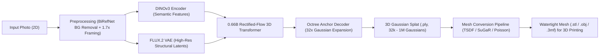
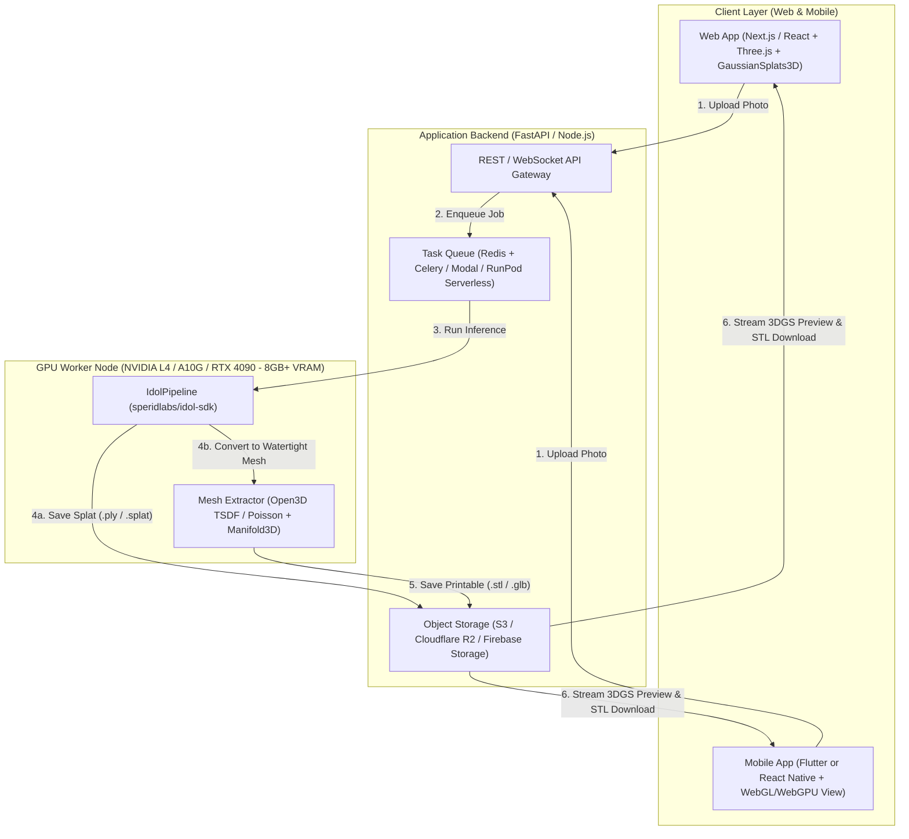

# Building a Photo-to-3D App with `speridlabs/idol-sdk` (Web & Mobile)

## 1. Understanding `speridlabs/idol-sdk`

[**`speridlabs/idol-sdk`**](https://github.com/speridlabs/idol-sdk) is an open-source (Apache 2.0) inference SDK for **Idol**, a 0.66B-parameter 3D Diffusion Transformer (Rectified Flow Transformer) developed by Sperid Labs. It transforms a **single 2D image** (real-world photograph, render, or AI image) into a complete 360° **3D Gaussian Splat (`.ply`)** in seconds on a single consumer GPU (~7.2 GB VRAM).

### How the Idol Pipeline Works Under the Hood


1. **Automated Preprocessing (`--mode real` vs `--mode synthetic`)**:
   - Uses **BiRefNet** to automatically strip the background from a phone photo.
   - Crops, centers, and applies a framing factor (`1.7x` in `real` mode) so the object sits cleanly in canonical space.
2. **Dual Visual Conditioning**:
   - **DINOv3 (`facebook/dinov3-vith16plus-pretrain-lvd1689m`)**: Extracts rich 3D-aware semantic features so the model understands what the object is and what its unseen back/sides should look like.
   - **FLUX.2 VAE (`black-forest-labs/FLUX.2-dev`)**: Preserves sharp pixel-level surface details.
3. **Rectified-Flow 3D Transformer + Octree Decoding**:
   - Jointly denoises the 3D latent volume and camera pose.
   - Uses an **octree decoder** to predict coarse spatial anchors, then expands each anchor into 32 local 3D Gaussians—scaling from **32,768** (fast preview) up to **1,048,576** Gaussians (high detail).

---

## 2. Why Gaussian Splatting Isn't Immediately 3D-Printable (And How to Bridge It)

### 3D Gaussian Splatting (3DGS) vs. 3D Printing Meshes
| Property | 3D Gaussian Splat (`.ply`) | 3D Printing Mesh (`.stl` / `.3mf` / `.obj`) |
| :--- | :--- | :--- |
| **Representation** | Cloud of fuzzy, semi-transparent 3D ellipsoids with view-dependent color (Spherical Harmonics) | Watertight (manifold) surface made of connected triangles with a clearly defined inside & outside |
| **Strengths** | Ultra-fast generation, photorealistic rendering, handles thin/fuzzy structures well | Required by slicers (Bambu Studio, PrusaSlicer, Cura) to compute toolpaths and infill |
| **Failure Mode in Slicers** | Slicers cannot slice a cloud of disconnected ellipsoids directly | Non-manifold edges, holes, or floating internal geometry cause slicing failures |

### 3 Ways to Convert Idol's Gaussian Splats into Printable 3D Meshes

To make your app both a **fun interactive 3D Splat viewer** and a **3D-printing creator tool**, add a **Post-Processing Mesh Extraction stage** on the backend:

#### Approach A: Multi-View Depth Fusion (TSDF + Marching Cubes) — *Fastest & Most Reliable for Idol*
Since `idol-sdk` produces a clean 360° Gaussian Splat of an isolated object:
1. Render 36–72 orbital views (RGB + expected Gaussian depth + alpha mask) around the generated `.ply` using the `gsplat` or `diff-gaussian-rasterization` rasterizer (takes < 0.5 seconds on GPU).
2. Fuse the depth maps into a **Truncated Signed Distance Field (TSDF)** volume using `Open3D` (`open3d.pipelines.integration.ScalableTSDFVolume`).
3. Extract a surface mesh with **Marching Cubes**, then run `trimesh` / `manifold3d` to make it 100% watertight and export `.stl` or `.3mf`.

#### Approach B: Point-Cloud Normal Estimation + Screened Poisson Reconstruction
1. Filter out low-opacity Gaussians ($\alpha < 0.1$) from `output.gaussian`.
2. Treat the Gaussian centers $(x, y, z)$ as a dense point cloud (up to 1M points) and derive normals from the shortest axis of each Gaussian's covariance quaternion/scale matrix (or orient normals outward via `Open3D`).
3. Run **Screened Poisson Surface Reconstruction** (`open3d.geometry.TriangleMesh.create_from_point_cloud_poisson(pcd, depth=9)`), crop low-density artifacts, and export to `.stl`.

#### Approach C: Hybrid Pipeline (Preview in 3DGS, Print via Mesh-Native Model or GOF/SuGaR)
- Use `idol-sdk` (`num_gaussians=262_144`) for an **instant 2-second interactive 3D Gaussian Splat preview** on the user's phone/browser.
- When the user taps **"Prepare for 3D Print"**, run either the TSDF/Poisson extractor above or pass the segmented image into a companion SDF/Mesh model (e.g., TRELLIS.2 / NVIDIA PartPacker / Hunyuan3D-2.1 / TripoSG) to output a sharp CAD-ready `.stl`.

---

## 3. Landscape of Image-to-3D Models (NVIDIA & Open-Weights Comparison)

If your end goal is **3D printing**, it helps to understand where `idol-sdk` sits relative to **NVIDIA's 3D models** and other open-weights **Mesh / SDF native** generators.

### Summary Comparison Table

| Model | Creator | Release Date | Model Size (Params) | VRAM Needed | Native Output | 3D Print Readiness | License |
| :--- | :--- | :--- | :--- | :--- | :--- | :--- | :--- |
| **Idol (`idol-sdk`)** | Sperid Labs | Oct 2026 | **0.66B** core (~1.8B w/ encoders) | **~7.2 GB** | 3D Gaussian Splat (`.ply`, up to 1M splats) | Needs Splat-to-Mesh post-processing (Poisson / TSDF) | Apache 2.0 (encoders gated) |
| **PartPacker** | **NVIDIA Research** | June 2025 | **~1.5B** (DiT + Dual-Volume VAE) | **~10 GB** (FP16) | **Separable Multi-Part Meshes** (`.glb` / `.stl` / `.3mf`, $512^3$) | **Excellent** (generates separate printable parts!) | NVIDIA Source Code License |
| **LLaMA-Mesh** | **NVIDIA** & Tsinghua | Nov 2024 | **8B** (Llama-3.1-8B fine-tune) | ~16 GB | Direct `.obj` vertices & faces via LLM tokens | Low–Medium (low-poly artistic/blockout meshes) | NVIDIA / Llama 3.1 License |
| **Edify 3D** | **NVIDIA** (NIM / Picasso) | Nov 2024 | Proprietary multi-stage DiT | Cloud API | Quad/Triangle Mesh + 4K PBR Textures | High (clean topology, commercial API only) | Commercial API |
| **Latte3D** | **NVIDIA Research** | Mar 2024 | Amortized U-Net / Triplane | ~24 GB | Textured Mesh (< 1 sec from prompt/image) | Medium (designed for real-time virtual scenes) | Research / Closed |
| **TRELLIS.2** *(and TRELLIS v1)* | Microsoft Research | Dec 2025 *(v1: Dec 2024)* | **4B** (`TRELLIS.2-4B`) / **2B** (`v1`) | ~16–24 GB | **O-Voxel -> `.glb` Mesh** ($1536^3$) or **3DGS** | **Excellent** (ultra-sharp geometry & native mesh/3DGS) | **MIT License** |
| **Hunyuan3D 2.1** *(and 2.0 / 2mini)* | Tencent | June 2025 *(2.0: Jan 2025)* | **1.1B–3.3B** (Shape DiT) + **2B** (Paint) / **0.6B** (`2mini`) | ~10 GB (shape only) / ~24 GB (w/ paint) | **Watertight SDF Mesh** (`.obj` / `.glb` / `.stl`) | **Excellent** (industry-leading sharp edges for 3D printing) | Tencent Community License |
| **TripoSG** | VAST / Tripo AI | Mar 2025 | **1.5B** (Rectified Flow + SDF VAE) | ~10–12 GB | **Signed Distance Field (SDF) -> Mesh** | **Excellent** (trained on 2M curated SDF pairs; very clean normals) | MIT License |
| **SAM 3D** (`Objects` & `Body`) | Meta AI | Nov 2025 | Foundation model suite | ~12–16 GB | Textured 3D Object & Human Body Meshes | High (great forin-the-wild photo segmentation + 3D) | Meta SAM License |
| **SPAR3D** *(and SF3D)* | Stability AI | Jan 2025 *(SF3D: Aug 2024)* | **~1.1B** (Point Diffusion + Triplane LRM) | **~7–8 GB** | Point Cloud + UV-Unwrapped Mesh in **0.7s** | Medium–High (super fast, allows point-cloud editing before meshing) | Stability Community License |
| **TripoSR** | Stability AI & Tripo | Mar 2024 | **~0.3B** (300M Transformer LRM) | **~6 GB** | NeRF Triplane -> Marching Cubes Mesh (0.5s) | Medium (fast & lightweight, but softer geometry than 2025/2026 DiTs) | MIT License |

---

### Deep Dive into Key Alternatives

#### 1. NVIDIA's 3D Model Ecosystem
NVIDIA has tackled 3D generation across several distinct architectures depending on the use case:
* **NVIDIA PartPacker (`NVlabs/PartPacker`, June 2025 — ~10 GB VRAM)**:
  * **Why it's special for 3D Printing:** Almost all image-to-3D models output a single fused "blob" mesh. **PartPacker** uses a *Dual Volume Packing* Diffusion Transformer to decompose a single 2D image into **separate, semantically meaningful 3D parts** at $512^3$ resolution. For 3D printing, this means you can print different parts in different filament colors, print moving/articulated assemblies, or orient individual parts to minimize support material.
* **NVIDIA Edify 3D (Nov 2024) & Latte3D (Mar 2024)**:
  * **Edify 3D** is NVIDIA's enterprise microservice (available via NVIDIA NIM / Shutterstock) focused on clean quad/triangle topology and 4K PBR textures.
  * **Latte3D** pioneered sub-second (~400ms) amortized 3D generation using triplane representations.
* **NVIDIA LLaMA-Mesh (Nov 2024 — 8B parameters)**:
  * Fine-tuned from `Llama-3.1-8B-Instruct`, it outputs `.obj` vertex and face coordinates directly as text tokens—allowing conversational 3D mesh generation and editing.

#### 2. Top Open-Weights Native-Mesh Models for 3D Printing
If you want crisp mechanical edges or watertight meshes *without* converting from Gaussian Splats:
* **Microsoft `TRELLIS` (2B, Dec 2024) & `TRELLIS.2` (4B, Dec 2025)**:
  * Uses a unified Structured Latent (`SLAT` / `O-Voxel`) representation that can decode the **exact same latent** into **both a 3D Gaussian Splat AND a high-resolution Mesh** (up to $1536^3$ in `TRELLIS.2`). Licensed under **MIT**.
* **Tencent `Hunyuan3D 2.0 / 2.1` (1.1B–3.3B Shape DiT, Jan–June 2025) & `Hunyuan3D-2mini` (0.6B, Mar 2025)**:
  * Since 3D printing (FDM/SLA) often only needs geometry (no UV paint texture required), you can run **only the `Hunyuan3D-DiT` shape model** (or the `0.6B` `2mini` model) in ~8–10 GB VRAM. It uses a Signed Distance Function (SDF) decoder (`FlashVDM`), producing watertight, razor-sharp meshes ready for slicers.
* **Tripo AI `TripoSG` (1.5B, Mar 2025)**:
  * Specifically uses **SDF + surface normal + eikonal loss supervision** during training, which eliminates the "lumpy/melted" surfaces common in older NeRF/3DGS conversions.
* **Stability AI `SPAR3D` (Jan 2025)**:
  * Generates a 3D point cloud in stage 1 and a mesh in stage 2 in **0.7 seconds**. Users can actually edit the intermediate point cloud in the UI before the final mesh is generated.

### Which Model Strategy Should We Use for Your App?
You don't have to lock your app into a single model! Because our backend uses a clean `/api/v1/generate-3d` interface, we can support a **Dual-Engine Architecture**:
1. **Engine 1 — `speridlabs/idol-sdk` (0.66B, 7.2 GB VRAM)**: Best for **photorealistic 3D Gaussian Splat previews** from real-world phone photos (handles fuzzy textures, hair, foliage, and real-photo background cropping out of the box), paired with our `Open3D` Poisson/TSDF mesh exporter.
2. **Engine 2 — `Hunyuan3D-2mini` (0.6B) / `TripoSG` (1.5B) / `NVIDIA PartPacker`**: Can be toggled when the user selects **"High-Precision CAD / Multi-Part 3D Print Mode"** for crisp, native SDF/part-separated `.stl` / `.3mf` output.

---

## 4. End-to-End App Architecture (Web + Mobile)

Because `idol-sdk` requires an NVIDIA GPU with CUDA (~7.2 GB VRAM) and PyTorch 2.5+, the heavy ML inference runs on a **GPU Backend API**, while the **Web and Mobile clients** handle camera capture, interactive 3D Gaussian Splat rendering, and `.stl` download/slicing.



### Recommended Tech Stack

| Layer | Technology Choices | Why It Fits |
| :--- | :--- | :--- |
| **Web Frontend** | **Next.js (React)** + **Three.js (`@react-three/fiber`)** + **`@mkkellogg/gaussian-splats-3d`** or **`PlayCanvas SuperSplat`** | Renders `.ply` / `.splat` files at 60 FPS in any desktop or mobile browser using WebGL/WebGPU. |
| **Mobile App** | **Flutter** (with `flutter_inappwebview` / Three.js canvas or `flutter_gpu`) or **React Native (Expo + `expo-gl`)** | Single codebase for iOS & Android with native camera access, AR preview, and embedded 60 FPS Gaussian Splat viewer. |
| **Backend API** | **Python FastAPI** | Runs natively in the same Python 3.10+ / PyTorch 2.5+ ecosystem as `idol-sdk`. |
| **GPU Hosting** | **Modal.com**, **RunPod Serverless**, **Replicate**, or a local **NVIDIA RTX** workstation | Since Idol only needs ~7.2 GB VRAM, an inexpensive **NVIDIA L4**, **RTX 4070/4090**, or **A10G** handles requests in 2–4 seconds. |
| **Storage** | **Cloudflare R2** / **AWS S3** / **Firebase Storage** | Stores input photos, compressed `.splat` files (4x smaller than `.ply`), and `.stl` files. |

---

## 5. Backend Implementation Blueprint (`FastAPI` + `idol-sdk` + `STL` Export)

### Running on NVIDIA DGX Spark (GB10 Grace Blackwell — 128 GB Unified Memory)
Moving development to your **NVIDIA DGX Spark** is ideal:
- **128 GB Unified Memory**: You can keep **`idol-sdk`** (~7.2 GB), **`TRELLIS.2-4B`** (~16 GB), **`Hunyuan3D-2.1`** (~24 GB), and **`NVIDIA PartPacker`** (~10 GB) **all loaded in memory at the same time** without swapping.
- **ARM64 (`aarch64`) + Blackwell (`sm_120` / CUDA 12.8+) Notes**:
  1. Because DGX Spark uses an ARM64 Grace CPU + Blackwell GPU, use **NVIDIA's pre-built PyTorch NGC container** (`nvcr.io/nvidia/pytorch:25.03-py3` or newer) or install PyTorch nightly/stable with CUDA 12.8 `aarch64` wheels so CUDA extensions compile cleanly.
  2. Expose the FastAPI server on `0.0.0.0:8000` so your laptop browser and phone (on the same Wi-Fi/LAN) can snap photos and hit the DGX Spark directly.

### Step 1: Environment Setup on the GPU Server / DGX Spark
```bash
# 1. Clone idol-sdk
git clone https://github.com/speridlabs/idol-sdk.git
cd idol-sdk
pip install -e .

# 2. Install API & Mesh Conversion dependencies
pip install fastapi uvicorn python-multipart trimesh open3d manifold3d numpy

# 3. Authenticate Hugging Face (after accepting terms for DINOv3 and FLUX.2-dev)
export HF_TOKEN="hf_your_token_here"
```

### Step 2: FastAPI Inference & Mesh Conversion Service (`server.py`)
```python
import os
import uuid
import numpy as np
import open3d as o3d
import trimesh
from fastapi import FastAPI, UploadFile, File, Query
from fastapi.responses import FileResponse
from idol import IdolPipeline

app = FastAPI(title="Idol Image-to-3D & Printable Mesh API")

# Load Idol model into GPU VRAM once at startup (~7.2 GB VRAM)
pipeline = IdolPipeline.from_pretrained("speridlabs/idol")

OUTPUT_DIR = "./outputs"
os.makedirs(OUTPUT_DIR, exist_ok=True)


def ply_splat_to_watertight_stl(ply_path: str, stl_path: str, poisson_depth: int = 8) -> str:
    """
    Converts an Idol 3D Gaussian Splat (.ply) into a watertight 3D-printable .stl mesh.
    """
    pcd = o3d.io.read_point_cloud(ply_path)

    # Remove statistical outliers (floating Gaussians)
    pcd, _ = pcd.remove_statistical_outlier(nb_neighbors=20, std_ratio=2.0)

    # Estimate and orient normals consistently outward
    pcd.estimate_normals(
        search_param=o3d.geometry.KDTreeSearchParamHybrid(radius=0.05, max_nn=30)
    )
    pcd.orient_normals_consistent_tangent_plane(30)

    # Screened Poisson Surface Reconstruction
    mesh, densities = o3d.geometry.TriangleMesh.create_from_point_cloud_poisson(
        pcd, depth=poisson_depth
    )

    # Prune low-density extrapolations
    densities = np.asarray(densities)
    vertices_to_remove = densities < np.quantile(densities, 0.05)
    mesh.remove_vertices_by_mask(vertices_to_remove)

    # Save intermediate mesh and repair with Trimesh for 3D printing
    o3d.io.write_triangle_mesh(stl_path, mesh)
    t_mesh = trimesh.load(stl_path)

    # Scale to a practical 3D print height (e.g., 100mm tall) and flatten bottom base
    scale_factor = 100.0 / t_mesh.extents.max()
    t_mesh.apply_scale(scale_factor)
    t_mesh.fill_holes()
    t_mesh.export(stl_path)
    return stl_path


@app.post("/api/v1/generate-3d")
async def generate_3d(
    file: UploadFile = File(...),
    mode: str = Query("real", enum=["real", "synthetic"]),
    num_gaussians: int = Query(262144, description="32768 to 1048576"),
    export_stl: bool = Query(True, description="Also generate a 3D-printable STL mesh"),
):
    job_id = str(uuid.uuid4())
    input_path = os.path.join(OUTPUT_DIR, f"{job_id}_input.jpg")
    ply_path = os.path.join(OUTPUT_DIR, f"{job_id}.ply")
    stl_path = os.path.join(OUTPUT_DIR, f"{job_id}.stl")

    with open(input_path, "wb") as f:
        f.write(await file.read())

    # 1. Run Idol 3D Gaussian Splat generation
    output = pipeline(
        image=input_path,
        mode=mode,
        seed=42,
        num_gaussians=num_gaussians,
    )
    output.gaussian.save_ply(ply_path)

    # 2. Optionally convert Gaussian Splat to printable STL
    if export_stl:
        ply_splat_to_watertight_stl(ply_path, stl_path)

    return {
        "job_id": job_id,
        "splat_url": f"/api/v1/download/{job_id}.ply",
        "stl_url": f"/api/v1/download/{job_id}.stl" if export_stl else None,
    }


@app.get("/api/v1/download/{filename}")
async def download_file(filename: str):
    path = os.path.join(OUTPUT_DIR, filename)
    return FileResponse(path)
```

---

## 6. Frontend Implementation (Web & Mobile)

### Web Viewer Component (React + `@mkkellogg/gaussian-splats-3d`)
In your web app (and inside a WebView on Mobile), you can render the `.ply` file returned by `idol-sdk` with orbit controls:

```tsx
import { useEffect, useRef } from "react";
import * as GaussianSplats3D from "@mkkellogg/gaussian-splats-3d";

interface SplatViewerProps {
  plyUrl: string;
  stlUrl?: string;
}

export function SplatViewer({ plyUrl, stlUrl }: SplatViewerProps) {
  const containerRef = useRef<HTMLDivElement>(null);

  useEffect(() => {
    if (!containerRef.current) return;

    const viewer = new GaussianSplats3D.Viewer({
      rootElement: containerRef.current,
      cameraUp: [0, -1, 0],
      initialCameraPosition: [0, 0, 2.5],
      initialCameraLookAt: [0, 0, 0],
    });

    viewer.addSplatScene(plyUrl, {
      splatAlphaRemovalThreshold: 5,
      showLoadingUI: true,
    }).then(() => {
      viewer.start();
    });

    return () => {
      viewer.dispose();
    };
  }, [plyUrl]);

  return (
    <div className="flex flex-col h-full w-full">
      <div ref={containerRef} className="flex-1 min-h-[500px] bg-neutral-900 rounded-xl overflow-hidden" />
      {stlUrl && (
        <div className="mt-4 flex gap-3">
          <a
            href={stlUrl}
            download="model.stl"
            className="px-4 py-2 bg-blue-600 text-white rounded-lg font-medium"
          >
            Download 3D Printable .STL
          </a>
        </div>
      )}
    </div>
  );
}
```

### Mobile App Flow (iOS & Android)
1. **Camera Capture Overlay**: Guide the user to take a well-lit photo of a single object or figurine with a clear silhouette (Idol's `--mode real` uses `1.7x` framing automatically).
2. **Quality Selector**:
   - **Fast Preview (`32,768` or `262,144` Gaussians)**: Loads quickly over mobile data (~5–15 MB `.splat`).
   - **High Detail (`1,048,576` Gaussians)**: Best for desktop viewing and high-resolution mesh extraction.
3. **3D Printing Pedestal / Base Generator (Bonus Feature for 3D Printing)**:
   - Before exporting the `.stl`, offer a toggle in the mobile UI: **"Add Flat Pedestal Base"**. Using `trimesh.creation.cylinder()` on the backend, boolean-union a 3mm cylindrical base to the bottom of the extracted mesh so figurines stand upright on the 3D printer bed without tipping over.

---

## 7. Roadmap to Build & Launch Your Prototype

1. **Phase 1 — Local CLI & Quality Test (Day 1)**
   - Clone `speridlabs/idol-sdk` on an NVIDIA GPU machine, accept the Hugging Face gates for `DINOv3` and `FLUX.2-dev`, and test `python -m idol.sample --image my_photo.jpg --mode real`.
   - Inspect the `.ply` output in [SuperSplat](https://playcanvas.com/supersplat/editor).
2. **Phase 2 — Splat-to-STL Pipeline Tuning (Days 2–3)**
   - Test both **Screened Poisson** and **Multi-View TSDF depth fusion** on Idol's `.ply` outputs and slice the resulting `.stl` in Bambu Studio / PrusaSlicer to verify manifold geometry.
3. **Phase 3 — Web & Mobile MVP (Days 4–7)**
   - Wrap `IdolPipeline` in the FastAPI server above.
   - Build a responsive Next.js PWA (works on both desktop browsers and mobile Safari/Chrome camera upload) or a Flutter mobile client.
