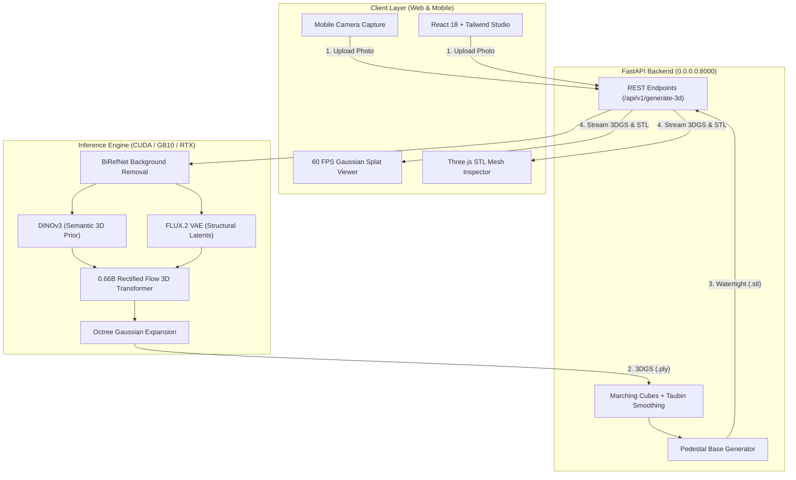

# Idol 3D Studio: Single-Image to 3D Gaussian Splats & Printable Meshes

[](LICENSE)
[](https://python.org)
[](https://pytorch.org)
[](https://developer.nvidia.com/cuda-toolkit)
[](https://react.dev)
[](https://fastapi.tiangolo.com)

**Idol 3D Studio** turns a single 2D photograph (from your phone, camera, or render) into a complete, photorealistic 360° **3D Gaussian Splat (`.ply`)** and a watertight, slicer-ready **3D-printable mesh (`.stl`)** in seconds.

Built on top of [**`speridlabs/idol-sdk`**](https://github.com/speridlabs/idol-sdk) (0.66B Rectified-Flow 3D Diffusion Transformer), featuring an integrated **Marching Cubes + Taubin mesh extraction pipeline** and a responsive **Web & Mobile 3D viewer** with native camera capture.

---

## 🌟 Key Features

- 📸 **Single-Image 3D Reconstruction**: Snap or upload a photo of any object, toy, or figurine with automatic background removal (**BiRefNet**) and adaptive 1.7x canonical framing.
- ✨ **Dual Visual Conditioning**:
  - **Meta DINOv3 (`dinov3-vith16plus`)**: Infers high-level 3D spatial priors, object symmetry, and predicts unseen backs/sides.
  - **Black Forest Labs FLUX.2 VAE**: Preserves crisp surface textures, micro-geometry, and true camera-view colors.
- ⚡ **Consumer GPU Friendly (~7.2 GB VRAM)**: Generates 3D models in 2–4 seconds on RTX 4070/4090, A10G, L4, or Grace Blackwell (tested on NVIDIA GB10).
- 🖨️ **3D-Print Ready (Watertight STL Export)**:
  - Uses **Marching Cubes** + **Taubin Laplacian Smoothing** on Gaussian point volumes to guarantee closed 2-manifold geometry with zero slicing holes.
  - Optional **Upright Pedestal Generator**: Automatically adds a flat, slicer-friendly cylindrical base so figurines stand securely on printer build plates.
- 📱 **Mobile & Desktop PWA Viewport**:
  - **3D Gaussian Splat Tab**: 60 FPS orbit rendering via WebGL/WebGPU (`@mkkellogg/gaussian-splats-3d`).
  - **3D Slicer Mesh Tab**: Realistic filament preview with print-bed grid, wireframe inspection, and triangle statistics.
  - Direct camera trigger on mobile browsers (iOS Safari / Android Chrome) over LAN.

---

## 🏗️ Architecture



---

## 🚀 Quickstart

### 1. Prerequisites & Hugging Face Access
Idol uses two gated vision encoders from Hugging Face. Accept their terms with your HF account:
1. [facebook/dinov3-vith16plus-pretrain-lvd1689m](https://huggingface.co/facebook/dinov3-vith16plus-pretrain-lvd1689m)
2. [black-forest-labs/FLUX.2-dev](https://huggingface.co/black-forest-labs/FLUX.2-dev)

Export your token:
```bash
export HF_TOKEN="hf_your_token_here"
# Or save to your Hugging Face cache:
huggingface-cli login
```

### 2. Environment Setup
```bash
# Clone the repository
git clone https://github.com/your-username/idol-3d-studio.git
cd idol-3d-studio

# Create Python virtual environment
python3 -m venv .venv
source .venv/bin/activate

# Install idol-sdk
git clone https://github.com/speridlabs/idol-sdk.git
pip install -e ./idol-sdk

# Install dependencies
pip install -r backend/requirements.txt
```

### 3. Build Frontend & Launch
```bash
# Build React client (only needed once or after frontend modifications)
cd frontend
npm install
npm run build
cd ..

# Start the full-stack server
./run_backend.sh
```

- **Desktop**: Visit `http://localhost:8000`
- **Phone / Tablet on Local Wi-Fi**: Visit `http://<YOUR_LOCAL_IP>:8000`

---

## 🛠️ API Reference

### Health Check
`GET /api/v1/health`
```json
{
  "status": "online",
  "cuda_available": true,
  "device": {
    "device_name": "NVIDIA GB10",
    "device_capability": [12, 1],
    "memory_allocated_gb": 6.05
  },
  "hf_status": {
    "token_configured": true,
    "dinov3_access": true,
    "flux2_access": true
  }
}
```

### Generate 3D Model
`POST /api/v1/generate-3d` (Multipart Form)

| Parameter | Type | Default | Description |
| :--- | :--- | :--- | :--- |
| `file` | `UploadFile` | *Required* | Input image (JPEG, PNG, WEBP) |
| `mode` | `str` | `"real"` | `"real"` (BiRefNet auto-crop 1.7x) or `"synthetic"` (render tight crop 1.2x) |
| `num_gaussians` | `int` | `262144` | Splat count (`32768` fast preview, `262144` balanced, `1048576` high detail) |
| `export_stl` | `bool` | `true` | Extract watertight 3D-printable `.stl` |
| `add_pedestal` | `bool` | `false` | Union flat cylindrical base for upright bed adhesion |

**Response:**
```json
{
  "job_id": "a1b2c3d4",
  "status": "success",
  "ply_url": "/api/v1/download/a1b2c3d4.ply",
  "stl_url": "/api/v1/download/a1b2c3d4.stl",
  "input_preview_url": "/api/v1/download/a1b2c3d4_input.jpg"
}
```

---

## 🖨️ 3D Printing Recommendations

| Slicer | Suggested Settings |
| :--- | :--- |
| **Bambu Studio / OrcaSlicer** | 0.16mm Optimal or 0.12mm High Detail, Tree Supports (Auto), 15% Gyroid Infill |
| **PrusaSlicer** | 0.15mm Structural, Organic Supports, 2 Perimeters |
| **Cura** | 0.16mm Layer Height, Tree Supports, Concentric Bottom Pattern |

*Tip:* When printing figurines, enable **"Add Flat Pedestal Base"** in the UI to give the model a wide, stable contact area on textured PEI build plates without requiring large rafts.

---

## 📂 Project Structure

```
.
├── backend/
│   ├── app.py                 # FastAPI service & static file routing
│   ├── pipeline_service.py    # GPU memory & Idol model management
│   ├── mesh_converter.py      # Marching Cubes & watertight STL extraction
│   └── requirements.txt       # Python dependencies
├── frontend/
│   ├── src/
│   │   ├── App.jsx            # Main studio application
│   │   ├── components/
│   │   │   ├── SplatViewer.jsx # 3D Gaussian Splat canvas
│   │   │   └── MeshViewer.jsx  # Three.js 3D print inspector
│   ├── vite.config.js         # Proxy & build configuration
│   └── package.json
├── outputs/                   # Auto-generated .ply & .stl models
├── run_backend.sh             # Launch script (host 0.0.0.0)
└── README.md
```

---

## 📜 License & Credits

- Core image-to-3D architecture by [Sperid Labs (`speridlabs/idol-sdk`)](https://github.com/speridlabs/idol-sdk) under Apache 2.0.
- Vision encoders: Meta AI [DINOv3](https://huggingface.co/facebook/dinov3-vith16plus-pretrain-lvd1689m) and Black Forest Labs [FLUX.2](https://huggingface.co/black-forest-labs/FLUX.2-dev).
- Gaussian Splat rendering via [`@mkkellogg/gaussian-splats-3d`](https://github.com/mkkellogg/GaussianSplats3D) and [Three.js](https://threejs.org).
